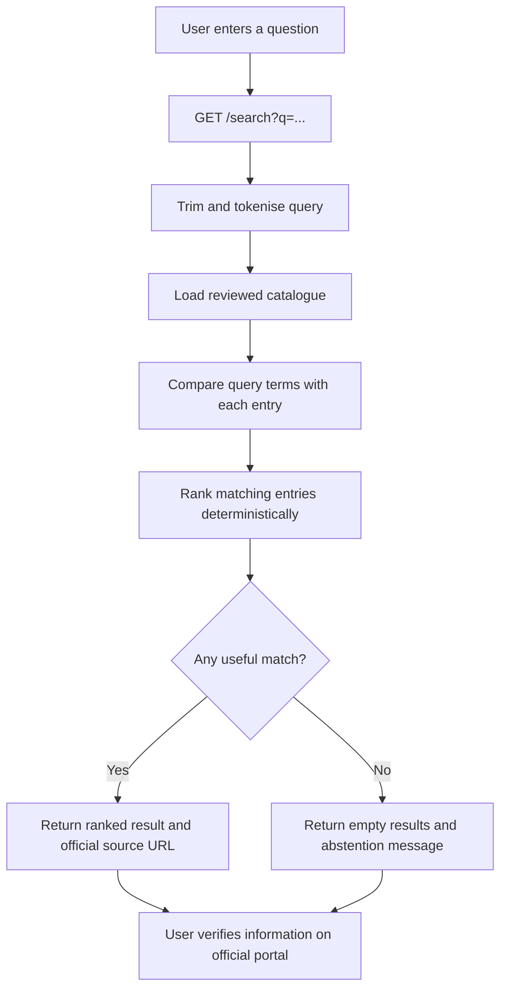
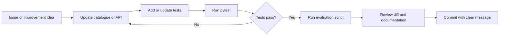

# CivicGuide Knowledge Assistant — End-to-End Process Map

## Developer workflow

## How to explain it in an interview

"I built a small source-grounded retrieval API. It normalises a query, ranks a reviewed catalogue using deterministic token overlap, and returns the official source with each match. When it cannot find a match, it abstains. I added unit tests and a small labelled evaluation set so the behaviour is measurable. It is a retrieval baseline, not an LLM, and I documented where semantic search could improve it."
